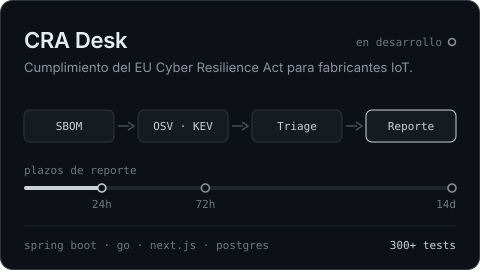
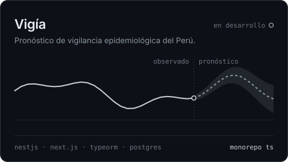
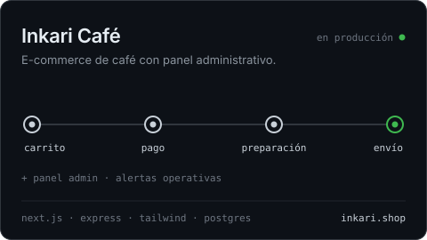
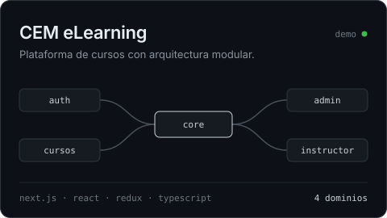

  

  
  
  

  
  
  

---

## Sobre mí

Soy **Anthony Daniel Díaz Yacsahuanga**, desarrollador **full stack** con experiencia construyendo módulos corporativos, plataformas académicas y productos SaaS **de punta a punta**: desde el modelo de datos y la API hasta una interfaz clara y responsive.

Vengo de la **Ingeniería Industrial**, así que pienso en procesos: entiendo el flujo de negocio antes de escribir código y busco que cada módulo elimine trabajo manual.

- 🏢 Hoy desarrollo módulos financieros full stack en **Grupo CORIL**
- 🧱 Me apasionan las arquitecturas modulares: **Clean / Screaming Architecture**, Repository, Adapter
- 🗄️ Me gusta optimizar datos: una consulta mía **duplicó la velocidad** de búsqueda de productos en PostgreSQL
- 🌱 Ahora mismo aprendo **Java (Spring Boot)** y **Go** construyendo [CRA Desk](https://github.com/Anthony-diaz-y/cra-desk)

## Stack tecnológico

<table>
  <tr>
    <td width="140"><b>Frontend</b></td>
    <td></td>
  </tr>
  <tr>
    <td><b>Backend</b></td>
    <td></td>
  </tr>
  <tr>
    <td><b>Datos & DevOps</b></td>
    <td></td>
  </tr>
</table>

## Proyectos destacados

  
  

  
  

## Experiencia

  

---

  <b>¿Buscas a alguien que entienda el negocio y entregue software de punta a punta?</b> 
  <a href="https://www.linkedin.com/in/anthony-daniel-diaz-yacsahuanga-2408b3399/">Hablemos en LinkedIn</a> · <a href="mailto:anthony.diaz.yacsahuanga@gmail.com">anthony.diaz.yacsahuanga@gmail.com</a>

